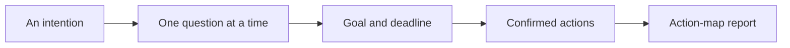

# Goal Action Coach

**English** · [简体中文](README.zh-CN.md)

Big intentions deserve a next action you can recognize when you see it.



A Codex Skill that turns “I want to do X” into a measurable goal, a specific deadline, and an action map. The conversation moves one question at a time.

## What comes out

- A result described with numbers or an observable picture.
- A deadline precise to a date and hour.
- Intermediate deliverables when the goal needs them.
- Actions that state a verb, an object, and the details needed to start.
- A list of required time, tools, money, people, and prior knowledge.
- A four-part action-map report.

The user confirms the goal, the action structure, and the final checklist. After each question, the coach reflects the current unfinished state so progress remains visible.

## Install and try

Copy this repository to `~/.codex/skills/goal-action-coach/`, or use your Skill Installer.

```text
Use $goal-action-coach to turn my idea of giving a short public talk
into a measurable goal with a deadline and actions I can follow.
```

## Inside and validation

[SKILL.md](SKILL.md) is the entry point. References explain [goal concretization](references/concretize-script.md), [action planning](references/decompose.md), and the [report](references/action-map-report.md). [The presentation example](examples/ppt-talk.md) shows the method in use.

```bash
scripts/validate.sh
```

[MIT License](LICENSE).
